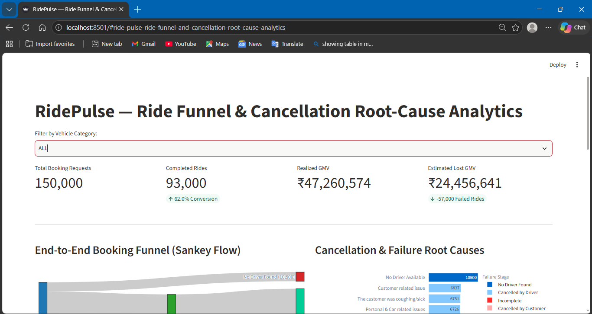
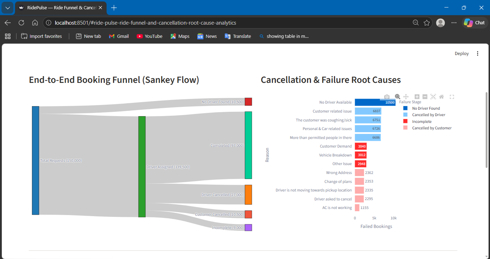
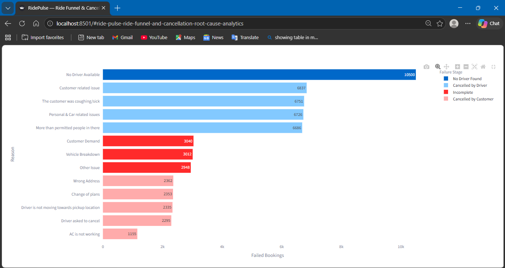
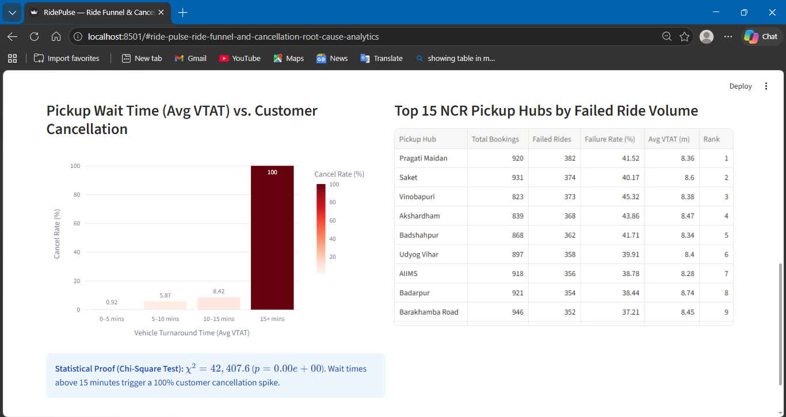

# RidePulse — Statistical Ride-Hailing Funnel & Cancellation Root-Cause Platform

An end-to-end mobility analytics system built with **MySQL 8.0**, **Python (`Pandas`, `SciPy`, `Plotly`)**, and **Streamlit** to analyze 150,000 NCR ride bookings, quantify Gross Merchandise Value (GMV) leakage, and test pickup wait-time (`Avg VTAT`) cancellation thresholds.

## Repository Structure
```text
RidePulse/
├── .streamlit/
│   └── secrets.toml.example   # Copy to secrets.toml and add local MySQL credentials
├── assets/
│   └── Failure_Root_Cause.png 
    └── Dashboard_main1.png
    └── Dashboard_main2.png
    └── Dashboard_main3.png
├── .gitignore
├── README.md
├── requirements.txt
├── schema.sql                 # MySQL 8.0 3NF tables, views, and stored procedure
├── load_data.py               # Python ETL loader for ncr_ride_bookings.csv
└── app.py                     # Interactive Streamlit + Plotly dashboard

```
## Executive Overview & KPIs


- **Funnel Conversion Tracking:** Monitors total requests (`150,000`), completed rides (`93,000` / `62.0%`), realized GMV (`₹47,260,574`), and revenue lost to cancellations (`₹24,456,641`)[cite: 11].
- **Dynamic Category Filtering:** Powered by parameterized SQL queries and MySQL stored procedures (`GetCancellationBreakdown`) for instant drill-downs across 7 vehicle tiers[cite: 2].

---

## End-to-End Booking Funnel & Failure Root Causes




- **Interactive Sankey Flow:** Visualizes drop-off transitions from initial request (`150,000`) to driver assignment (`139,500`) and final completion vs. driver/customer cancellations[cite: 12, 15].
- **Stage-Segmented Diagnostics:** Separates supply shortages (*No Driver Available*, `10,500` failed bookings) from driver-side cancellations (e.g., *Customer related issue*, *Personal & Car related issues*) and customer-side cancellations (e.g., *Wrong Address*, *Change of plans*)[cite: 14].

---

## Statistical Wait-Time Proof & Pickup Hub Ranking


- **Hypothesis Testing (SciPy Chi-Square):** Proves a statistically significant relationship ($\chi^2 = 42,407.6, p < 0.0001$) between Vehicle Turnaround Time (Avg VTAT) and customer cancellations—showing a 100% cancellation spike once wait times exceed 15 minutes[cite: 2, 13].
- **Location Bottleneck Leaderboard:** Uses SQL window functions (`vw_location_cancellation_rank`) to rank the top 15 pickup hubs by failed ride volume and failure rate[cite: 2, 13, 16].

---

## Tech Stack
- **Database:** MySQL 8.0 (Normalized Schema, SQL Views, Stored Procedures)[cite: 2]
- **Backend & Analytics:** Python, SQLAlchemy, Pandas, SciPy (Chi-Square Contingency Testing)[cite: 2]
- **Frontend & Visualization:** Streamlit, Plotly (Sankey Diagrams & Interactive Bar Charts)[cite: 2]

---

## Quick Setup
1. **Install Dependencies:**
   ```bash
   pip install -r requirements.txt
   ```
2. **Initialize MySQL Database:**
   Execute `schema.sql` in MySQL Workbench or CLI (`localhost:3306`) to create `ncr_rides_db`.
3. **Configure Secrets:**
   Copy `.streamlit/secrets.toml.example` to `.streamlit/secrets.toml` and enter your MySQL credentials.
4. **Load Dataset (`ncr_ride_bookings.csv`):**
   Place `ncr_ride_bookings.csv` in the root folder and run:
   ```bash
   python load_data.py
   ```
5. **Run Dashboard:**
   ```bash
   streamlit run app.py
   ```
